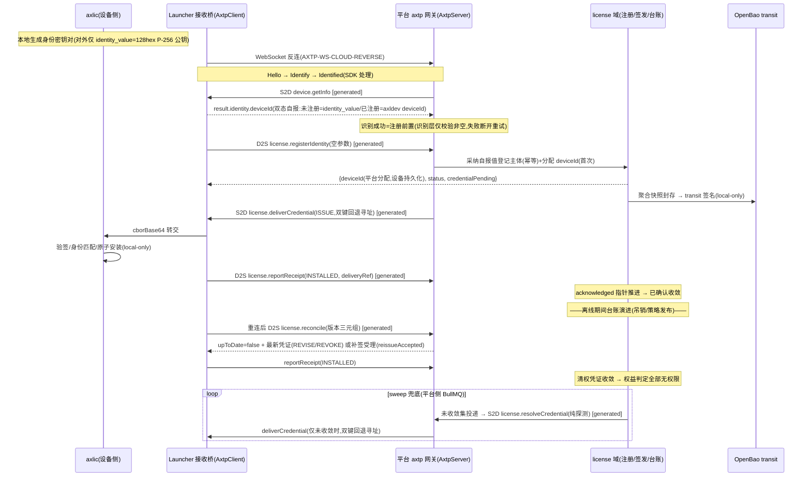

# License Entitlement Lifecycle Protocol Interaction Flow

> Status: flow design
> Scope: 设备权益授权（license）全生命周期——云反连接入识别、连接即注册、凭证自动签发与下发、安装回执、对账收敛、吊销/清权、凭证解绑换绑、策略批量修订的设备 ↔ 平台协议交互
> Source inputs: 上游业务规格（设备权益授权系统，平台侧特性规格——业务语义权威）、`contract/generated/protocol.md`、`contract/protocol/axtp.protocol.yaml`、`contract/registry/domains/device/domain.yaml`、`workspace/protocol/system/system.license.md`
> Protocol lifecycle: Stage 10 `plan-protocol-flow`
> Re-reviewed: 2026-11-19——同步上游设备身份定案（平台分配 deviceId / 双态自报 / S2D 双键回退寻址 / 0x7001 双态判定），coverage 复核为 complete

本文根据上游权益授权系统（平台侧）业务规格，梳理设备经 axtp 云反连通道"连接即注册即获凭证"、以及此后吊销/策略变更经推拉双通道对账收敛的 AXTP 交互流程，判断每一步协议覆盖状态并识别缺口。

本文不是最终协议事实源；已采纳事实以 `contract/registry/**/*.yaml`、`contract/registry/domains/**/*.yaml`、`contract/protocol/axtp.protocol.yaml` 和 `contract/generated/**` 为准。license 域事实已于 2026-11-18 采纳（domain `0x19`、方法 `0x1901`–`0x1905`、capability `0x1901`–`0x1903`、vendor 错误码 `0x7001`–`0x7003`）并于 2026-11-19 经 `amend-adopted-protocol` 完成 deviceId 口径修正；本场景协议覆盖 complete。后续语义变更 MUST 走 `workspace/protocol/license/**` 草案修订 + `amend-adopted-protocol`。

Flow 文档负责：

- 描述权益授权的业务场景和交互步骤。
- 判断每一步协议覆盖状态。
- 识别协议缺口。
- 将缺口路由到 candidate `domain.feature`。

Flow 文档不负责：

- 定义完整 method / event / schema / capability。
- 分配 methodId / eventId / errorCode / fieldId。
- 作为 runtime implementation contract。
- 替代 `workspace/protocol/<domain>/<feature>.md`。

完整 method / event / schema / capability 定义必须进入 `workspace/protocol/<domain>/<feature>.md`。

## 0. 速读结论

| 项目 | 内容 |
|---|---|
| Flow 目标 | 设备（接收桥 + axlic 身份模块）经 axtp 云反连 WebSocket JSON RPC 通道连接即注册，平台按默认策略自动签发 CBOR V1 签名凭证并下发、设备验签安装回执；此后吊销/换绑/策略变更经推（deliverCredential）拉（reconcile）双通道最终一致收敛。 |
| 当前协议覆盖 | complete |
| 涉及 domain.feature | `device.info`（generated，连接识别）；`license.registration` / `license.credentialDelivery` / `license.reconciliation`（均已采纳，见 §8.2 拆分） |
| 已有 adopted/generated | AXTP-WS-CLOUD-REVERSE 云反连传输（`axtp.protocol.yaml:155-169`）；session 握手 Hello → Identify → Identified；`device.getInfo`（0x0101，registry status: draft、已进 generated 输出；`DeviceIdentity.deviceId` fieldId 0x01）；license 域 5 方法（0x1901–0x1905）+ 3 capability（0x1901–0x1903）+ vendor 错误码 0x7001–0x7003（`contract/registry/domains/license/domain.yaml`、`contract/registry/error/error_code.yaml`）；common 段错误码（NOT_SUPPORTED / TIMEOUT / INVALID_ARGUMENT=0x000A / UNAVAILABLE=0x000F 等——上游契约所引 3/6/62 值与 registry 不符，见 OQ-6） |
| 缺口 | 无新增缺口。遗留修正已完成：已采纳的 deviceId 约束原为旧口径（设备本地 `dev_`+32hex、36 字符），2026-11-19 经 `amend-adopted-protocol` 修正为平台分配 `axldev_`+32hex（40 字符）+ 双态自报 + 双键回退寻址（OQ-7）。 |
| 是否需要新增协议草案 | no（license 域已采纳；后续变更走 amend） |
| 是否涉及 Legacy | no（legacy SN 桥接体系已随上游规格修订整体废除） |
| 是否涉及 STREAM | no（纯 Request/Response；**不使用自定义事件**——SDK broker 丢弃带点号的未注册事件名，为对草案的硬约束） |
| 下一步 | 无新增协议工作。helloSender 角色矛盾（OQ-1）待核实，若协议文本需修正则转 `amend-adopted-protocol`。 |

## 1. Story Summary

| Item | Content |
|---|---|
| User goal | "哪些设备能用哪些功能"成为可运营管控的事实：设备零人工接入即持有可离线验证的签名凭证；运营方可吊销/换绑/调整策略，设备侧权益判定随双通道下发与对账最终收敛。 |
| Trigger | 全新设备首次经 axtp 云反连通道连接平台（识别成功后设备主动发起注册）。 |
| Success result | 注册 → 自动签发 → 下发 → 安装确认全链路无人工介入；离线设备上线后经对账取台账最新凭证、不丢失不重复；吊销后在线设备在一个收敛 SLA 周期内清权收敛；策略发布触发批量修订且不产生修订风暴。 |
| Primary actors | 设备 axlic（本地身份密钥对管理、凭证验签/安装/权益判定，C++ 外部依赖）；launcher 接收桥（AxtpClient，axtp 客户端 + 凭证转交/回执上报，外部依赖）；平台 axtp 网关（AxtpServer @8081，device-connectivity 传输复用）；平台 license 域（注册/签发/下发/对账台账）；管理员（REST 管理面）；OpenBao transit（签名后端，平台内部）。 |
| Product scope | Windows 设备（launcher 接收桥）+ 上游 SaaS 平台；本期免费全量授权，付费条目仅目录登记（上游运营配置与部署规模不入本仓记录）。 |

上游规格 8 个用户故事中：连接即注册获凭证、吊销、凭证解绑换绑、对账收敛、策略发布批量修订 5 个故事含协议交互，为本 flow 主体；凭证交叉验证为 axlic 冻结合同的跨端一致性问题（non-protocol）、管理面查询/登录为 HTTP REST（non-protocol）。

## 2. Source Observations

### 2.1 UI / Prototype

| Screen or control | Observed behavior | Protocol relevance |
|---|---|---|
| （无 UI 原型） | 本场景为设备 ↔ 平台机对机流程，无用户界面；管理面本期无界面、仅 REST 语义。观测面 = 管理面查询接口（台账组合状态 + 失败明细）。 | 设备通道协议设计不受 UI 约束；错误/不支持行为须经台账查询面可见（Acceptance Gate 4 的等价落点）。 |

### 2.2 Requirement Notes

- **识别是注册前置（双态自报）**：平台在连接 ready 后经 S2D `device.getInfo` 取 `result.identity.deviceId` 作为连接寻址键（deviceUniqueId，指当前自报值）。该字段**双态**：未注册（或本地注册引用丢失）设备自报 **identity_value**（axlic 对外唯一身份材料——128 位小写 hex 的 P-256 公钥，`^[0-9a-f]{128}$`）；已注册设备自报**平台分配的 deviceId**（`^axldev_[0-9a-f]{32}$`，注册响应返回、设备本地持久化）。识别层仅校验非空（不做格式校验）；识别失败（身份未就绪）重试耗尽断开，为连接层正确行为，不构成异常。
- **注册采纳制、幂等、平台分配**：`registerIdentity` 请求参数为空对象——自报值恒取连接上下文（防参数层覆盖连接身份，防冒用内建）。采纳校验**双态正则**：匹配 identity_value `^[0-9a-f]{128}$` 且无既有映射 → 创建主体并由**平台分配** deviceId（`axldev_`+32hex，响应返回，设备 MUST 本地持久化）；匹配 `^axldev_[0-9a-f]{32}$` 或 identity_value 命中既有映射 → 幂等 EXISTING 恒返回**同一** deviceId（identity 重解析恒回同一主体）。双态正则均不匹配 = 0x7001 **终态错误**（设备应重建本地身份，非可重试暂态）；占用（identity_value 已映射其他主体）同码。
- **S2D 双键回退寻址**：全部 S2D 方法（resolveCredential 探测 / deliverCredential / T2 上线推送 / 在线判定）统一**双键回退**——优先已注册 deviceId，未命中经 identity 映射回退 identity_value（首注册同连接窗口）；设备侧对寻址无感知。reportReceipt / reconcile / resolveCredential 的 `params.deviceId` = 连接寻址键当前自报值（平台回退寻址时该字段填连接当前自报值）。
- **注册与归属解耦**：注册不携带工作空间归属；license 域零工作空间信息；凭证解绑换绑与工作空间绑定操作完全独立、无编排关系。
- **多 Grant 聚合为一份凭证**：设备可同时持有多个有效 Grant，聚合投影（entitlement_id 去重 + merge_mode 合并）后每设备每时刻仅一份在途聚合凭证；设备对多授权来源无感知。
- **串行下发、超时 ≠ 失败**：同设备同时刻至多一张在途凭证；通道超时/断连归"结果未知"，等对账收敛，不判失败、不重发覆盖新版本。
- **回执采信条件**：回执必须可关联平台真实下发尝试（deliveryId 闭环）且工件一致才被采信；EXPORTED 不视为安装成功；不可关联假回执被拦截，可关联假回执（冒用连接持真 deliveryId）为本期已知风险（通道鉴权为演进项）。
- **对账为权威**：比对凭证版本 (authorityRevision, credentialGeneration) 与策略行集版本（policyVersion = revision_no）两个维度；reconcile 有三种应答形态：upToDate=true / 携带最新凭证 / 补签受理（reissueAccepted，不携带凭证字节）。台账未收敛集四类（①指针未收敛 ②有 Grant 无凭证/零授权链 ③REVOKED 未清权 ④聚合漂移）各有路由触发动作。
- **吊销双粒度、台账即时生效**：Grant 级吊销按剩余 Grant 重算聚合凭证（reason=REVISE，权益收窄）；设备级吊销终结全部 Grant + 清权凭证（空权益集，reason=REVOKE）；权威态 REVOKED 超过 N×SLA 未收敛自动转"放弃送达"**粘性终态**（晚到收敛回执仍采信但不翻回、链不可恢复）；吊销后重注册不恢复任何授权（恢复仅经管理面 RESTORED 分支）。
- **凭证演进单调防回滚**：(修订号, 代次) 字典序单调不回退；设备拒绝版本低于本地高水位的凭证（0x7003 LICENSE_CREDENTIAL_STALE）。
- **通道侧元数据**：`policyVersion`（行集版本）与 `deliveryId` 不在 CBOR 载荷内（axlic 冻结合同不可增字段），由通道消息捎带、设备本地持久化后经 reconcile / resolveCredential 上报。
- **通道滥用定案**：D2S responder 不加独立限流（千级设备并发上线为合法场景，重放幂等无危害）；凭证字节本身非机密（签名体系 + 设备身份绑定使其装不进他机）；付费期再收紧通道鉴权。
- **方法命名与实装策略**：WS-JSON 线上走字符串方法名（SDK 不校验注册表），平台实现不被注册表阻塞；domain `0x19`、方法 ID `0x1901`–`0x1905`、capability `0x1901`–`0x1903` 已采纳注册（上游"不得长期维护私设方法语义"的对齐要求已满足）。

### 2.3 Device / System State Observations

| State | Meaning | Protocol relevance |
|---|---|---|
| unconnected / identifying | 设备未反连或身份未就绪，识别重试中。 | precondition；识别失败断开重试为连接层正确行为（generated 会话层）。 |
| identified / session ready | 握手完成，双态自报值已绑定为连接寻址键（未注册=identity_value / 已注册=axldev deviceId）。 | precondition；S2D `device.getInfo`（generated）。 |
| unregistered → registered | 设备主体未登记 → 采纳自报值登记主体并由平台分配 deviceId（幂等，REGISTERED/EXISTING，identity_value 或 deviceId 命中恒返回同一 deviceId）。 | `license.registerIdentity`（generated）；credentialPending 标志未收敛。 |
| credentialPending | 台账存在未收敛（四类口径），凭证将经推送或后续对账取得。 | registerIdentity result 字段（generated）；设备勿同步等待。 |
| in-flight delivery | 该设备有一张在途凭证（串行约束）。 | `license.deliverCredential`（generated）；超时归结果未知。 |
| installed / converged | 设备已按 deliveryId 回执安装确认，acknowledged 指针推进（只进不退）。 | `license.reportReceipt`（generated）。 |
| authority ACTIVE / REVOKED | 授权链权威态两值（无挂起中间态），台账侧即时生效。 | 平台台账派生（local-only）；协议面经 reason=REVOKE/REVISE 下发表达。 |
| delivery PENDING / CONVERGED / ABANDONED | 送达观测三态；ABANDONED 经统一超时派生、粘性终态。 | 平台账派生（local-only）；放弃链设备仍可主动 reconcile 取清权凭证。 |
| offline → online | 离线期间台账演进，上线后必须对账。 | `license.reconcile`（generated）；千级设备并发上线削峰（平台侧）。 |

## 3. Assumptions And Non-Goals

| Type | Item | Status |
|---|---|---|
| Assumption | 上游业务规格（设备权益授权系统，平台侧特性规格）为业务语义权威；本 flow 只做协议覆盖判定与缺口路由。 | `[REVIEW-OK]` |
| Assumption | `@axtp/ts-sdk@0.17.0` 实装事实成立：WS-JSON method 恒为字符串名、无注册表校验；带点号未注册事件名被 broker 静默丢弃 → licensing 域全 Request/Response、零自定义事件。 | `[REVIEW-DRAFT]`（以 SDK 源码为证，上游技术调研定案） |
| Assumption | deviceId 格式约束 `^axldev_[0-9a-f]{32}$`（40 字符，平台注册时分配）与 identity_value `^[0-9a-f]{128}$`（恰 128 = `DeviceIdentity.deviceId` max 上限内）属 license 域采纳校验，不构成 device 域修订。 | `[REVIEW-OK]` |
| Assumption | CBOR V1 凭证格式（SignedEnvelopeV1 / CredentialPayloadV1，条目 ≤256、工件 ≤64KiB、low-S）为 axlic 冻结合同，经通道以 `cborBase64` 不透明传输，不进入 AXTP schema 定义。 | `[REVIEW-OK]` |
| Non-goal | 不定义 method schema / 错误码语义表 / fieldId——全部在 `workspace/protocol/license/**` 草案维护（已采纳）。 | `[REVIEW-OK]` |
| Non-goal | 不修改 registry / Protocol IR / generated / test-vectors（仅经 `amend-adopted-protocol` + generator 流程变更）。 | `[REVIEW-OK]` |
| Non-goal | 不设计管理面 REST、OpenBao 签名链路、数据库模型、BullMQ 队列/sweep——均为平台实现细节（local-only），不入协议。 | `[REVIEW-OK]` |
| Non-goal | 不定义通道鉴权 / 回执设备侧签名（axtp 会话层无鉴权为已知现状，可关联假回执为已登记已知风险；付费期演进项）。 | `[REVIEW-OK]` |
| Non-goal | 不覆盖 axlic 设备侧验证方合同与金向量（凭证交叉验证，权威在设备侧验证方冻结合同与语料集）。 | `[REVIEW-OK]` |

## 4. Protocol Coverage

| Need | Coverage state | AXTP protocol | Evidence | Next action |
|---|---|---|---|---|
| 云反连 WebSocket 传输（设备发起反连、公网 wss 由反代终结） | generated | transport `AXTP-WS-CLOUD-REVERSE`（unframed-json-cloud-reverse，production） | `contract/protocol/axtp.protocol.yaml:155-169`；`contract/generated/protocol.md` §transport | implement（复用既有网关） |
| 会话握手与心跳（Hello → Identify → Identified） | generated | session handshake；Identify 提交身份 + randomSeed + 可选鉴权数据 | `contract/generated/protocol.md:106` §session；角色矛盾见 OQ-1 | 核实 OQ-1；必要时 `amend-adopted-protocol` |
| 设备识别：取双态自报值作为连接寻址键 | generated | S2D `device.getInfo` → `result.identity.deviceId`（string, required, max 128；未注册=identity_value / 已注册=axldev deviceId，识别层仅校验非空） | `contract/registry/domains/device/domain.yaml:6,163`（registry status: draft）；`contract/generated/protocol.md:1892` | implement |
| 设备注册（幂等、空参数、平台分配 deviceId、双态正则、触发自动签发） | generated | `license.registerIdentity`（D2S，0x1901） | `contract/registry/domains/license/domain.yaml`；`contract/generated/protocol.md` §license | implement |
| 自动签发（快照聚合展开 → 封存 → OpenBao 签名 → 登记） | local-only | —（平台内部签发链，无协议调用） | 上游平台签发链内部设计 | no action（平台实现） |
| 凭证下发（双键回退寻址、串行、deliveryId/policyVersion/reason 捎带、cborBase64） | generated | `license.deliverCredential`（S2D，0x1904） | `contract/registry/domains/license/domain.yaml`；`contract/generated/protocol.md` §license | implement |
| 安装/导出/拒绝回执（deliveryRef 闭环、采信条件） | generated | `license.reportReceipt`（D2S，0x1902） | `contract/registry/domains/license/domain.yaml`；`contract/generated/protocol.md` §license | implement |
| 对账（拉通道、三应答形态、双维度比对） | generated | `license.reconcile`（D2S，0x1903） | `contract/registry/domains/license/domain.yaml`；`contract/generated/protocol.md` §license | implement |
| 版本探测（队列 worker 下发前纯探测、永不携带凭证字节） | generated | `license.resolveCredential`（S2D，0x1905） | `contract/registry/domains/license/domain.yaml`；`contract/generated/protocol.md` §license | implement |
| 通用错误（参数非法 / 不可用 / 不支持 / 超时） | generated | common 段：INVALID_ARGUMENT(0x000A)、UNAVAILABLE(0x000F)、NOT_SUPPORTED(0x0003)、TIMEOUT(0x0006) 等（registry 事实；SDK 内部 RpcMethodNotFound/RpcResponseTimeout 非 registry 错误，见 OQ-6） | `contract/registry/error/error_code.yaml:72,108`；`contract/generated/protocol.md` §errors | implement |
| licensing vendor 错误码（0x7001 双态身份无效/占用、0x7002 设备不存在、0x7003 凭证过旧防回滚） | generated | vendor 段已注册 0x7001–0x7003；上游候选码 0x7004–0x7006（NOT_ENTITLED / RATE_LIMITED / INTERNAL）维持不注册处置（见 `license.registration` §8） | `contract/registry/error/error_code.yaml`（0x7001–0x7003）；`specs/30-registry.md` vendor 段规则 | implement |
| license 业务域注册（domain 高字节） | generated | domain `license` = `0x19`（已注册） | `contract/registry/core/domain_registry.yaml` | none |
| 管理面六类操作 + 管理员登录（状态查询/签发下发/吊销/解绑换绑/目录运维/策略发布） | non-protocol | —（HTTP REST 管理面，非 AXTP） | 上游管理面 REST 契约 | no action |
| axlic 设备侧验签 / 身份匹配 / 原子安装 / 权益判定 | local-only | —（设备内部行为；凭证经通道不透明传输） | 设备侧验证方冻结合同 | no action（外部依赖） |
| 台账状态机 / 送达观测态派生 / 队列削峰 / sweep 兜底 / 平台进程内事件（license.device.registered 等） | local-only | —（平台实现；进程内事件非 axtp 事件） | 上游平台实现设计 | no action |
| CBOR V1 凭证格式合同 | non-protocol | —（axlic 冻结面，非 AXTP 协议事实） | 设备侧验证方冻结合同；上游凭证格式契约 | no action |

整体覆盖判定：**complete** —— 传输 / 会话 / 识别 / 全局错误码 / license 业务域（5 方法 + 3 capability + vendor 错误码 0x7001–0x7003 + 域注册 0x19）全部 generated；无新增缺口（2026-11-19 已完成 deviceId 旧口径修正，见 OQ-7）。

## 5. End-To-End Sequence

> **术语注记（D2S/S2D ↔ axtp 逻辑角色）**：本文 D2S/S2D 沿用上游规格的平台中心命名（S = 平台服务端）。在 axtp 协议 cloud-reverse 角色模型中（`axtp.protocol.yaml:164-169`）设备为 **logical server**、云为 **logical client**——"S2D"（平台→设备，如 `deliverCredential` / `device.getInfo`）对应逻辑客户端→逻辑服务端的正向调用，"D2S"（设备→平台，如 `registerIdentity`）则为反向调用；若 OQ-1 裁决以 SDK 实装角色模型为准则两组方向互换。方法集横跨双向 RPC（建模影响见 OQ-5）。

## 6. Interaction Steps

核心闭环（连接即注册即获凭证）：

| Step | Actor | Action | Capability / precondition | Protocol call/event | Payload fields | Result / state change | Coverage | Error / fallback |
|---:|---|---|---|---|---|---|---|---|
| 1 | axlic | 本地生成设备身份密钥对（TPM/软件 Provider） | 无（首次） | —（local-only） | 对外仅 identity_value = 128hex P-256 公钥 | 身份就绪，可反连 | local-only | 身份未就绪 → 连接被断开重试（连接层正确行为） |
| 2 | 接收桥 | WebSocket 反连 + 会话握手 | 网络可达、wss | —（transport/session，SDK 处理） | Hello / Identify / Identified | 会话 ready | generated | 断线重连；公网明文连接被拒 |
| 3 | 平台网关 | 连接识别：取双态自报值作寻址键 | 会话 ready | S2D `device.getInfo` | `result.identity.deviceId`（未注册=identity_value / 已注册=axldev deviceId，识别层仅校验非空） | 连接入册，deviceUniqueId = 当前自报值 | generated | 识别失败重试耗尽断开（身份未就绪非异常） |
| 4 | 接收桥 | 发起注册 | 识别成功 | D2S `license.registerIdentity` | params = `{}`（自报值恒取连接上下文） | REGISTERED/EXISTING + credentialPending；响应返回**平台分配 deviceId**（设备 MUST 持久化，后续连接自报该值）；触发自动签发（异步） | generated | 0x7001 双态正则均不匹配 = **终态**（重建本地身份）；identity_value 占用同码 |
| 5 | license 域 | 自动签发 | 注册受理 | —（local-only） | 多 Grant 聚合投影 → 封存 → OpenBao 签名 | 台账新增聚合凭证 + 下发指针 selected | local-only | 签发最终失败 → 未收敛集②，reconcile/sweep 补签（受理形态） |
| 6 | 平台网关 | 凭证下发（推通道、串行、双键回退寻址） | 凭证已登记、设备在线 | S2D `license.deliverCredential` | credentialId, deliveryId, authorityRevision, credentialGeneration, policyVersion, reason=ISSUE, cborBase64 | 设备收到唯一聚合凭证 | generated | 超时/断连 = 结果未知（不判失败，等对账）；accepted=false + 0x7003 防回滚 |
| 7 | axlic | 验签 / 身份匹配 / 原子安装 | 凭证字节到达 | —（设备侧 local-only） | CBOR V1 冻结合同校验 | 本地权益判定生效；持久化 policyVersion | local-only | 验证失败 fail-closed 判无权限，不阻断接收桥更新 |
| 8 | 接收桥 | 回执安装确认 | 已安装 | D2S `license.reportReceipt` | deviceId（连接当前自报值）, credentialId, outcome=INSTALLED, deliveryRef=deliveryId | acknowledged 指针推进 → 已确认收敛 | generated | 不可关联/工件不符 → accepted=false 台账不变 |

吊销 / 换绑（P2）：

| Step | Actor | Action | Capability / precondition | Protocol call/event | Payload fields | Result / state change | Coverage | Error / fallback |
|---:|---|---|---|---|---|---|---|---|
| 9 | 管理员 | Grant 级吊销（REST） | 管理会话 | —（non-protocol） | grantId | 该 Grant 翻 REVOKED，链保持有效 | non-protocol | — |
| 10 | 平台网关 | 剩余 Grant 重算聚合凭证下发 | 设备仍有有效 Grant | S2D `license.deliverCredential` | reason=REVISE（权益集收窄，版本轴单调递增） | 设备权益收窄非清零 | generated | 同步骤 6 |
| 11 | 管理员 | 设备级吊销 / 凭证解绑（REST） | — | —（non-protocol） | deviceId | 全部 Grant 终结，台账即时 REVOKED | non-protocol | — |
| 12 | 平台网关 | 清权凭证尽力下发 | 权威态已 REVOKED | S2D `license.deliverCredential` | reason=REVOKE，空权益集 cbor | 设备安装后全部判无权限 | generated | 在线设备 SLA 周期内收敛；超 N×SLA → 放弃送达（粘性终态，观测态不翻回）；离线设备上线经对账取清权凭证 |
| 13 | 管理员 | 凭证换绑 from→to（REST） | to 已注册 | —（non-protocol） | from/to deviceId | from 端 = 步骤 11+12 语义；to 沿用自身凭证不重签 | non-protocol | to 未注册 → REST 拒绝并提示先注册 |
| 14 | 接收桥 | 吊销后重连注册 | 权威态 REVOKED | D2S `license.registerIdentity` | `{}` | EXISTING 幂等命中（identity_value 重解析回同一主体），不恢复授权（credentialPending 按③清权口径） | generated | 恢复仅经管理面 RESTORED 分支（RESTORED 产物 reason=ISSUE 下发） |

对账收敛（P2）：

| Step | Actor | Action | Capability / precondition | Protocol call/event | Payload fields | Result / state change | Coverage | Error / fallback |
|---:|---|---|---|---|---|---|---|---|
| 15 | 接收桥 | 上线/重连对账（拉通道，必须执行） | 会话 ready | D2S `license.reconcile` | deviceId（连接当前自报值）, authorityRevision, credentialGeneration, policyVersion（无凭证时三元组省略） | 三应答形态之一（见下） | generated | 0x7002 设备不存在；全局错误码沿用 |
| 16 | 平台网关 | 对账应答①：台账最新凭证 | 台账版本更新 | `license.reconcile` result | upToDate=false + policyVersion + credential{credentialId, 版本对, reason, cborBase64} | 设备安装最新版（单调不回退、不重复） | generated | ④a/④b 漂移形态 MUST NOT 旧凭证捎带新行集版本 → 转补签受理 |
| 17 | 平台网关 | 对账应答②：补签受理 | 未收敛集②③④命中（签发失败/零授权链/清权未产出/聚合漂移） | `license.reconcile` result | upToDate=false + reissueAccepted=true（无凭证字节） | 异步重走签发链，产物经推送或后续对账取得 | generated | 幂等键防重；放弃链主动 reconcile 仍可触发清权补签 |
| 18 | 平台网关 | 对账应答③：已最新 | 指针自洽且聚合一致 | `license.reconcile` result | upToDate=true | 设备保持现状 | generated | 零授权链/未清权形态 MUST NOT 应答 upToDate=true |
| 19 | 队列 worker | 下发前版本纯探测 | sweep/上线触发投递 | S2D `license.resolveCredential` | deviceId（连接当前自报值；平台回退寻址时填连接当前自报值） | hasCredential + 版本三元组 → 平台比对决定是否下发 | generated | 永不返回凭证字节（探测与下发载荷语义分离）；0x7002 |

策略发布批量修订（P3）：

| Step | Actor | Action | Capability / precondition | Protocol call/event | Payload fields | Result / state change | Coverage | Error / fallback |
|---:|---|---|---|---|---|---|---|---|
| 20 | 管理员 | 目录登记/退役 + 策略发布（REST） | 管理会话 | —（non-protocol） | 行集校验 fail-closed | revision 版本+1 → POLICY_PUBLISHED 进程内事件 | non-protocol | 校验失败整体拒绝（422），无半发布版本 |
| 21 | license 域 | 批量聚合修订 + 分批下发 | 引用策略的全部有效 Grant | —（local-only）→ S2D `license.deliverCredential` | reason=REVISE，新行集权益集 | 每设备一次重写、削峰分批避免修订风暴 | generated + local-only | 离线设备上线经步骤 15-18 收敛 |

## 7. State Changes And Events

| State change | Trigger | Event needed | Payload | Client handling | Coverage |
|---|---|---|---|---|---|
| unregistered → registered（REGISTERED/EXISTING） | registerIdentity 受理 | **无 axtp 事件**——Request/Response 即答（credentialPending 表达未收敛） | status + deviceId（平台分配）+ credentialPending | 设备持久化 deviceId，等待 S2D 推送或后续 reconcile | generated |
| 台账新增/修订凭证（ISSUE/REVISE/REVOKE） | 自动签发/吊销剩余重算/批量修订/清权 | **无 axtp 事件**——S2D `deliverCredential` 主动调用承载 | 凭证 + 版本对 + policyVersion + reason | 设备验签安装并回执 | generated |
| acknowledged 指针推进（→ CONVERGED） | INSTALLED 回执且满足采信条件 | 无 | deliveryRef 闭环 | accepted=true；指针只进不退 | generated |
| authority ACTIVE → REVOKED（台账即时） | 设备级吊销/解绑/换绑 from 端 | 无（协议面经 reason=REVOKE 凭证表达） | 清权凭证 | 设备安装后全判无权限 | local-only + generated |
| 送达观测态 → ABANDONED（粘性终态） | REVOKED 超 N×收敛 SLA 未确认 | 无 | —（台账派生） | 晚到回执仍采信但观测态不翻回；设备仍可 reconcile 取清权凭证 | local-only |
| 设备凭证版本演进 | 收到更高 (revision, generation) 凭证 | 无 | 版本对比对 | 单调安装；低于高水位拒绝（0x7003） | generated |
| 平台进程内事件（license.device.registered / license.policy.published / license.converged） | 注册事务提交 / 发布事务提交 / 收敛 | **非 axtp 事件**（平台进程内事件，local-only） | — | 不进协议；SDK broker 丢弃未注册点号事件名为硬约束 | local-only |

**设计约束（对草案的输入）**：licensing 域零自定义事件——进度、状态变化、收敛信号全部经 Request/Response 与 S2D 主动调用表达；自定义事件名（带点号）会被 SDK broker 静默丢弃。

## 8. Protocol Details

### 8.1 Adopted / Generated Protocols

| Method/Event | Purpose in this flow | Source |
|---|---|---|
| transport `AXTP-WS-CLOUD-REVERSE` | 云反连 WebSocket JSON RPC 通道：设备物理客户端发起反连、仅 JSON、无 CONTROL/无 STREAM | `contract/protocol/axtp.protocol.yaml:155-169`；`contract/generated/protocol.md` §transport |
| session Hello → Identify → Identified + 心跳 | 会话握手与保活（SDK 内部处理）；Identify 携带身份 + randomSeed + 可选鉴权数据 | `contract/generated/protocol.md` §session（角色矛盾见 OQ-1） |
| `device.getInfo`（0x0101） | 连接识别：取 `result.identity.deviceId`（DeviceIdentity fieldId 0x01，string，required，max 128；双态自报——未注册=identity_value / 已注册=axldev deviceId）作为连接寻址键 | `contract/registry/domains/device/domain.yaml:6,163`；`contract/generated/protocol.md:1892` |
| `license.registerIdentity`（0x1901，D2S） | 设备主体注册（幂等、平台分配 deviceId、双态正则采纳、触发自动签发） | `contract/registry/domains/license/domain.yaml`；`contract/generated/protocol.md` §license |
| `license.reportReceipt`（0x1902，D2S） | 安装/导出/拒绝回执上报（采信条件） | 同上 |
| `license.reconcile`（0x1903，D2S） | 对账拉通道（三应答形态、双维度比对） | 同上 |
| `license.deliverCredential`（0x1904，S2D） | 凭证下发（双键回退寻址、串行、通道侧元数据捎带） | 同上 |
| `license.resolveCredential`（0x1905，S2D） | 下发前版本纯探测（永不携带凭证字节） | 同上 |
| capability `license.registration` / `license.credentialDelivery` / `license.reconciliation`（0x1901–0x1903） | 设备侧能力声明（注册意愿 / 接收验签安装 / 版本持久化上报） | `contract/registry/domains/license/domain.yaml` |
| vendor 错误码 0x7001 LICENSE_IDENTITY_INVALID / 0x7002 LICENSE_DEVICE_NOT_FOUND / 0x7003 LICENSE_CREDENTIAL_STALE | 双态身份无效（终态）/ 设备不存在 / 凭证过旧防回滚 | `contract/registry/error/error_code.yaml` |
| common 段错误码 INVALID_ARGUMENT(0x000A) / UNAVAILABLE(0x000F) / NOT_SUPPORTED(0x0003) / TIMEOUT(0x0006) | 通用通道错误（registry 事实；上游契约误引 3/6/62 值，见 OQ-6） | `contract/registry/error/error_code.yaml`；`contract/generated/protocol.md` §errors |

### 8.2 Adopted Protocol Facts（原缺口路由结果）

| 原 Gap | domain.feature | 方法/错误码 | 处置结果 |
|---|---|---|---|
| 设备注册（幂等、空参数、连接身份采纳、触发自动签发、credentialPending） | `license.registration` | `license.registerIdentity`（D2S，request_response） | **已采纳**（2026-11-18，0x1901）；deviceId 格式校验属 license 域语义；params 复用已注册 `Empty`、全字段忽略由规则层承载；2026-11-19 修正为平台分配 deviceId + 双态正则（OQ-7） |
| 凭证下发（串行、deliveryId/policyVersion/reason 通道侧元数据、cborBase64 不透明字节、0x7003 拒绝语义） | `license.credentialDelivery` | `license.deliverCredential`（S2D，request_response） | **已采纳**（0x1904）；凭证字段抽共享 `LicenseCredentialInfo` 内嵌结构；`cborBase64` `max_length: 87384`（64KiB 工件 Base64 含填充）；2026-11-19 补双键回退寻址注记 |
| 安装/导出/拒绝回执（deliveryRef 闭环、采信条件、EXPORTED 不算安装） | `license.credentialDelivery` | `license.reportReceipt`（D2S，request_response） | **已采纳**（0x1902）；采信不满足以 `accepted=false` 业务应答（不用 NOT_FOUND）；deviceId 字段 2026-11-19 改 axldev 格式（连接当前自报值） |
| 对账（拉通道、三应答形态、双维度版本比对、补签受理） | `license.reconciliation` | `license.reconcile`（D2S，request_response） | **已采纳**（0x1903）；三应答形态以字段缺席 + 互斥规则表达（不引入显式变体）；deviceId 字段 2026-11-19 改 axldev 格式（连接当前自报值） |
| 版本纯探测（队列 worker 前置探测、永不携带凭证字节） | `license.reconciliation` | `license.resolveCredential`（S2D，request_response） | **已采纳**（0x1905）；版本三元组与 reconcile params 复用共享 `LicenseVersionTriple`；deviceId 字段 2026-11-19 改 axldev 格式 + 平台回退寻址口径 |
| vendor 错误码 0x7001–0x7003（双态身份无效终态/设备不存在/凭证过旧） | `license`（域级 errors） | vendor 段错误码 | **已采纳**（0x7001–0x7003）；0x7005 限流码位保留不启用；vendor 段使用规则已写入 specs/30-registry.md；0x7001 描述 2026-11-19 改双态正则 + identity_value 占用语义 |
| license 业务域注册（domain 高字节 0x19、方法 ID 0x1901–0x1905） | `license`（新域） | domain registry | **已采纳**（0x19 已注册 `contract/registry/core/domain_registry.yaml`；OQ-3 关闭） |
| 既有 `system.license` 草案与本场景语义不匹配（泛型配置 CRUD vs 设备授权链生命周期） | —（命名治理） | — | **已处置**（2026-11-18 Stage 30 采纳时将 `system.license.md` 标记 superseded/deprecated，OQ-2 关闭） |

feature 拆分（registration / credentialDelivery / reconciliation 三文件，5 方法按生命周期归位）已按草案阶段建议落地：`workspace/protocol/license/license.registration.md` / `license.credentialDelivery.md` / `license.reconciliation.md`（status: generated，已采纳并刷新到 generated 产物）。

### 8.3 Recommended Payload Boundaries

- 方法 schema 素材以上游业务规格契约为权威输入（5 方法 params/result + 错误码表 + 时序）——已改写为 `workspace/protocol/license/**` 规范格式并采纳，本 flow 不复制其 schema 细节。
- 通道侧元数据 `deliveryId` / `policyVersion` / `reason` 为方法 schema 的协议字段（不在 CBOR 载荷内）；`cborBase64` 为不透明字节串（axlic 冻结合同），AXTP schema 只约束传输形态（string/Base64）与尺寸上限注记，不定义其内部结构。
- `deviceId` 字段复用 `DeviceIdentity.deviceId` 既有语义（≤128 字符 string），license 域格式约束（`^axldev_[0-9a-f]{32}$`，40 字符，平台注册时分配）与未注册连接自报 identity_value（`^[0-9a-f]{128}$`）双态口径作为方法级校验注记写入草案；reportReceipt / reconcile / resolveCredential 的 `params.deviceId` = 连接寻址键当前自报值。

## 9. Test / Conformance Notes

| Case | Given | When | Then | Protocol evidence |
|---|---|---|---|---|
| happy path：连接即注册即获凭证 | 目录主数据就绪，新设备首次反连（自报 identity_value） | 识别成功后 `registerIdentity`（空参数） | REGISTERED + 平台分配 deviceId + credentialPending=true，设备持久化 deviceId 后异步收 `deliverCredential`(ISSUE)，安装后 `reportReceipt`(INSTALLED) → 台账"待送达 → 已确认收敛" | `device.getInfo` + `license.*`（均已采纳，registry/generated） |
| 注册幂等与重解析 | 设备已注册并持有有效凭证（本地注册引用丢失，自报 identity_value 重连） | 断线重连后再次 `registerIdentity` / reconcile | EXISTING 命中恒返回同一 deviceId，无重复主体、无重复 Grant、凭证不重签 | `license.registerIdentity`（0x1901） |
| unsupported：身份不合规客户端 | 非 axlic 客户端自报任意非空串 | 连接识别成功后 `registerIdentity` | 双态正则均不匹配恒 0x7001 终态拒绝（设备应视为致命错误、重建本地身份后重试） | vendor 错误码 0x7001（已采纳） |
| 防回滚 | 设备持有高版本凭证 | 收到 (revision, generation) 低于高水位的 `deliverCredential` | accepted=false + 0x7003 LICENSE_CREDENTIAL_STALE | vendor 错误码 0x7003（已采纳） |
| 假回执不采信 | 台账存在某设备下发历史 | 提交无法关联真实下发尝试（无 deliveryId 对应/工件不符）的 `reportReceipt` | accepted=false，台账送达观测态不变 | `license.reportReceipt`（0x1902） |
| 吊销收敛 | 在线设备持有有效凭证 | 管理员设备级吊销 | 台账即时 REVOKED，清权凭证(REVOKE)下发，SLA 周期内收敛；超 N×SLA → 放弃送达（粘性） | `license.deliverCredential`（0x1904）+ 平台台账（local-only） |
| 对账收敛 | 设备离线期间台账两次演进 | 上线 `reconcile`（版本三元组） | 返回台账最新凭证（不取旧版、不重复安装），版本单调递增 | `license.reconcile`（0x1903） |
| 补签受理形态 | 有效授权存在但签发最终失败（或零授权链/清权未产出/聚合漂移） | 设备 `reconcile` | `{upToDate:false, reissueAccepted:true}`（不携带凭证字节），MUST NOT upToDate=true | `license.reconcile`（0x1903） |
| 下发超时 ≠ 失败 | 凭证在途 | 通道超时/断连 | 归结果未知（等对账），不判失败、不重发覆盖新版本 | `license.deliverCredential`（0x1904） |
| 事件路径 | — | — | **不适用**——licensing 域零自定义事件（SDK broker 约束），全部 Request/Response | 本 flow §7 设计约束 |

## 10. Acceptance Gates

- 所有依赖的 adopted/generated 事实（AXTP-WS-CLOUD-REVERSE、`device.getInfo`、license 域 5 方法 + 3 capability + vendor 错误码、全局错误码）在 generated registry 中可用；runtime 实现复用既有网关与 SDK 会话层。
- 平台与设备使用生成的 / 采纳后的 schema 承载协议载荷；正式方法 ID 与域值以 registry 采纳结果为准（0x19 / 0x1901–0x1905 已定）。
- 原 `missing` 缺口（5 方法 + vendor 错误码 + 域注册）已全部采纳并刷新 generated 产物（2026-11-18）；deviceId 旧口径修正已完成（2026-11-19，OQ-7）；`system.license` 草案重叠已裁决并标记 superseded（OQ-2）。
- 错误与不支持行为（0x7001 终态、0x7003 防回滚、结果未知归对账、假回执不采信）在台账查询面/失败明细可见（本场景无 UI，观测面 = 管理面查询接口）。

## 11. Open Questions

| Question | Impact | Owner | Status | Next action |
|---|---|---|---|---|
| OQ-1：云反连 Hello 发送方矛盾——协议 IR 定 `logicalServer: Device`、`helloSender: Device`（`axtp.protocol.yaml:164-169`），而上游技术调研记录 `@axtp/ts-sdk` 实装为平台 AxtpServer（逻辑服务端）先发 Hello、设备为客户端，且上游规格已按代码事实修正其对应需求条款。协议文本与 SDK 实装孰为权威？ | protocol（会话层正确性；影响所有云反连场景的互操作描述） | axtp 维护者 | REVIEW-ASK | 对照 `@axtp/ts-sdk` handshake 实现核实；若协议文本需修正 → `amend-adopted-protocol`；若 SDK 偏离规范 → SDK 修复跟踪 |
| OQ-2：既有骨架草案 `workspace/protocol/system/system.license.md`（泛型 license 配置查询/设置语义，未采纳）与新 `license` 域命名重叠且语义不匹配——旧草案是否废弃/改名？ | protocol（命名治理；避免两个 "license" 概念并存混淆采纳评审） | axtp 维护者 | executed（2026-11-18 Stage 30 采纳时已标记 deprecated/superseded） | 已关闭；`system.license.md` 停止维护 |
| OQ-3：domain 高字节 `0x19` 分配确认——registry 现至 0x18 止、0x19 为下一可用值；`workspace/legacy-migration/generated/registry-patches.generated.yaml` 中存在旧协议自身域表的 `"log": 0x19` 映射（与 AXTP 域注册表无关但易混淆）。 | protocol（域值唯一性；方法 ID 0x1901–0x1905 草案值的前置） | axtp 维护者 | decided（0x19 已注册 `contract/registry/core/domain_registry.yaml`；与 legacy 迁移映射无冲突） | 已关闭 |
| OQ-4：axtp 会话层无鉴权现状下，"可关联假回执"（冒用连接持真 deliveryId 代确认）为已登记已知风险——通道鉴权 / Identify 鉴权数据 / 回执设备侧签名（axlic A2）是否列入 axtp 协议演进路线？ | protocol / security（上线前演进项；影响回执采信与观测面可信度） | axtp 维护者 + 上游平台 | REVIEW-ASK（已知风险已接受） | 付费期/上线前评审；届时可能新增 `amend-adopted-protocol` 或新草案 |
| OQ-5：5 方法集横跨双向 RPC——云调用设备方法（`deliverCredential` / `resolveCredential` / 复用 `device.getInfo`）与设备调用云方法（`registerIdentity` / `reportReceipt` / `reconcile`）并存于同一会话；无论 OQ-1 裁决哪种角色模型，总有一组为"逻辑服务端发起的反向 Request"。registry 现按 domain 归属方法、无 endpoint 角色标注——双向 Request/Response 与实现方归属如何在 registry 建模？framed 二进制编码下方法 ID 的编解码归属随之受影响。 | protocol（registry 建模完整性；framed 路径的前向兼容） | axtp 维护者 | decided（2026-11-18 用户裁决） | 按业务域登记方法、不加「实现方」标注位；capability 维持设备侧声明（云侧实现方法不设 capability）；将来上 TLV 或 OQ-1 裁决后再评估升级 |
| OQ-6：上游方法契约引用通用错误码值「INVALID_ARGUMENT=3、UNAVAILABLE=6、RpcResponseTimeout=62 等」与 axtp registry 事实不符——registry 实况：INVALID_ARGUMENT=0x000A、UNAVAILABLE=0x000F（0x0003=NOT_SUPPORTED、0x0006=TIMEOUT）；RpcResponseTimeout / RpcMethodNotFound 为 `@axtp/ts-sdk` 内部码，不存在于 `contract/**` 任何事实源。草案与平台实现 MUST 以 registry 值为准；上游契约文本需勘误。 | protocol / conformance（跨仓一致性：按误引值实现将错映射为 NOT_SUPPORTED / TIMEOUT） | axtp 维护者 + 上游平台 | REVIEW-ASK（2026-11-19 补注：上游契约仍列 0x7004–0x7006 为通道码，axtp 仅注册 0x7001–0x7003、其余维持不注册处置；deviceId 双态/平台分配新口径已于 2026-11-19 同步进 axtp registry） | 草案已按 registry 值定稿；提请上游更正契约文本（不代改） |
| OQ-7：已采纳 deviceId 约束原为旧口径（设备本地产生 `dev_`+32hex、36 字符），与上游设备身份定案不符——2026-11-19 经 `amend-adopted-protocol` 修正：deviceId 平台注册时分配（`^axldev_[0-9a-f]{32}$`、40 字符、设备 MUST 持久化）、设备对外身份 = identity_value（128hex P-256 公钥）、device.getInfo 双态自报、S2D 双键回退寻址、0x7001 双态正则判定。ID/fieldId/bitOffset/name 全部保持（draft 状态下 breaking correction）。 | protocol（license 域 wire 约束正确性；与上游实现一致性） | axtp 维护者 | executed（2026-11-19） | 已关闭；后续上游身份语义变更继续走 amend 流程 |
